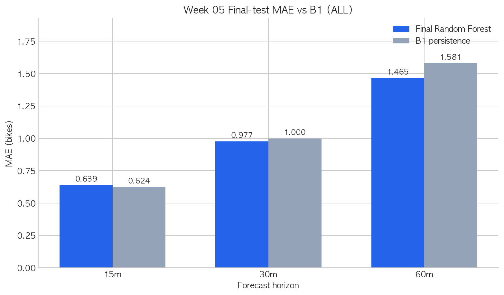
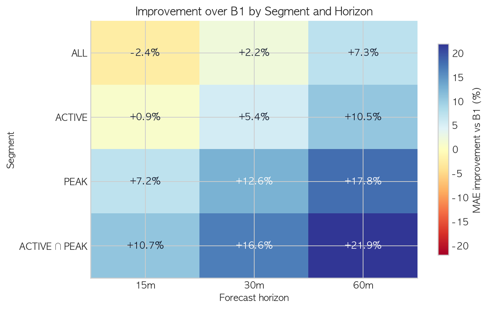
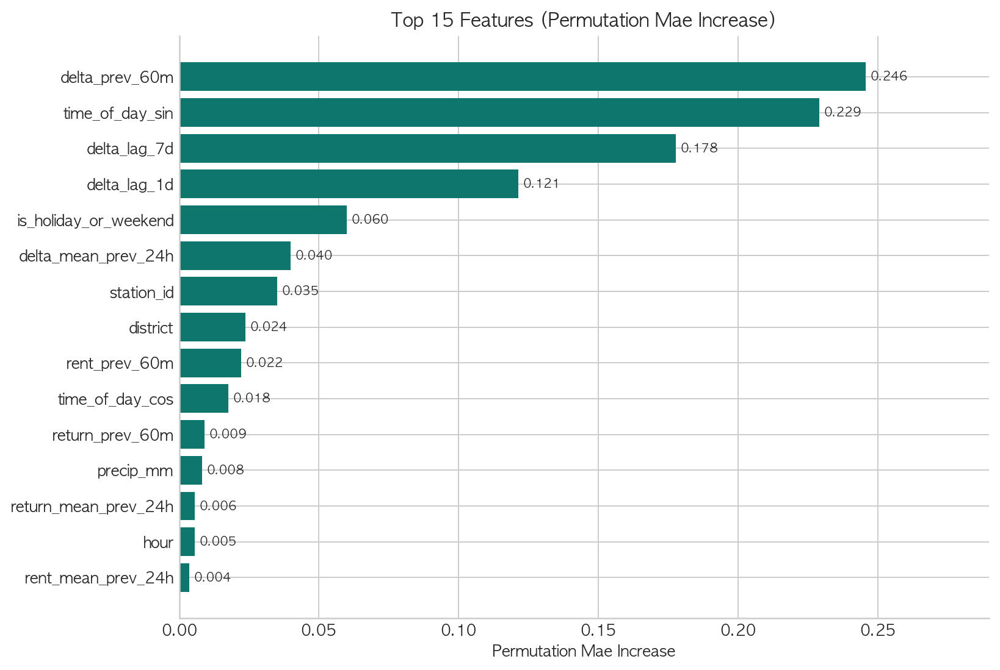

# Week 05 Independent Final-Performance Validation

Issue: #35

Reviewer: Kim Suyeon (`@rlatndusgu`)

Validation basis: `develop` commit `5958832`

## Scope

This report independently checks the committed Week 05 final-test metrics,
baseline improvements, inference timing, and feature-importance outputs. It does
not retrain or retune the model and does not claim the artifact-level rerun
required separately by Issue #34.

## Validation method

- Cross-checked `final_model_test_metrics.csv` against
  `final_model_metrics.csv` at byte level.
- Recomputed every B1 improvement as `(b1_mae - mae) / b1_mae`.
- Checked all four segments and all three horizons, for 12 result rows total.
- Verified the recorded test-access count and input checksum.
- Ran the Week 03–05 Python regression suite independently: 19 tests passed.
  The current Week 03–06 suite also passes all 27 tests on the PR branch.
- Reviewed inference timing and permutation importance without changing model
  parameters or reopening the final test for tuning.

The two committed metric files have the same SHA-256 prefix, `883b...`. The
largest absolute difference between stored and recomputed improvement values is
`5.91e-12`, attributable only to decimal serialization.

## ALL-segment results

| Horizon | Random Forest MAE | RMSE | B1 MAE | Improvement vs B1 |
|---|---:|---:|---:|---:|
| 15 minutes | 0.638877 | 1.124372 | 0.623763 | -2.42% |
| 30 minutes | 0.977497 | 1.625141 | 0.999658 | +2.22% |
| 60 minutes | 1.465295 | 2.380355 | 1.581251 | +7.33% |

The macro-average MAE is 1.027223 for Random Forest and 1.068224 for B1, a
3.84% average improvement. This average does not mean that every horizon
improved: the 15-minute ALL result is 2.42% worse than B1.

## Segment and horizon findings

| Segment | 15 minutes | 30 minutes | 60 minutes |
|---|---:|---:|---:|
| ALL | -2.42% | +2.22% | +7.33% |
| ACTIVE | +0.88% | +5.41% | +10.52% |
| PEAK | +7.19% | +12.61% | +17.83% |
| ACTIVE_PEAK | +10.71% | +16.63% | +21.92% |

The provisional 10% improvement target is met for:

- ACTIVE at 60 minutes;
- PEAK at 30 and 60 minutes;
- ACTIVE_PEAK at 15, 30, and 60 minutes.

It is not met for ALL at any horizon, ACTIVE at 15 or 30 minutes, or PEAK at
15 minutes. The model's clearest advantage is therefore concentrated in busy
periods and longer horizons, not uniformly across all station-times.

## Operational characteristics

Recorded inference time is 48.357 milliseconds per 1,000 rows, below the
provisional 200-millisecond threshold.

The five largest permutation-MAE increases on the registered ACTIVE_PEAK,
30-minute sample are:

| Feature | MAE increase |
|---|---:|
| `delta_prev_60m` | 0.245646 |
| `time_of_day_sin` | 0.229166 |
| `delta_lag_7d` | 0.177831 |
| `delta_lag_1d` | 0.121269 |
| `is_holiday_or_weekend` | 0.060046 |

The result supports the expected importance of recent net movement, daily time
cycle, and daily/weekly recurrence. Importance describes the registered sample
and is not a causal interpretation.

## Conclusion

Issue #35 is reproducible from the committed aggregate artifacts. The final
test results, same-row B1 references, improvement calculations, inference time,
and feature-importance ordering are internally consistent.

The final model should not be described as a universal B1 improvement. It is
weaker for ALL at 15 minutes and achieves the 10% target only in the specific
high-activity or peak cells listed above.

Artifact-level model loading and complete prediction rerun remain outside this
issue and require the uncommitted `final_model.joblib` and
`week03_features.parquet` inputs tracked by Issue #34.
