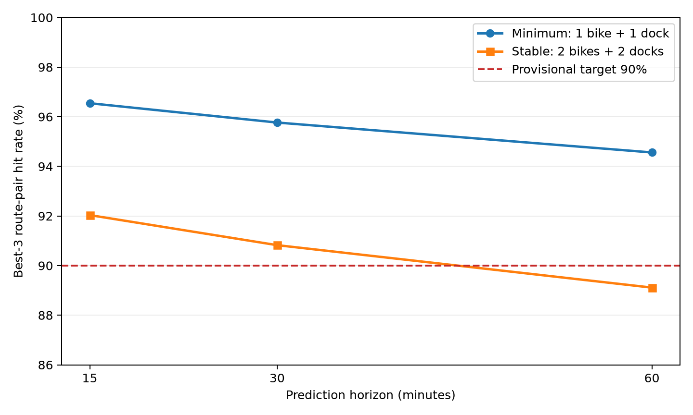
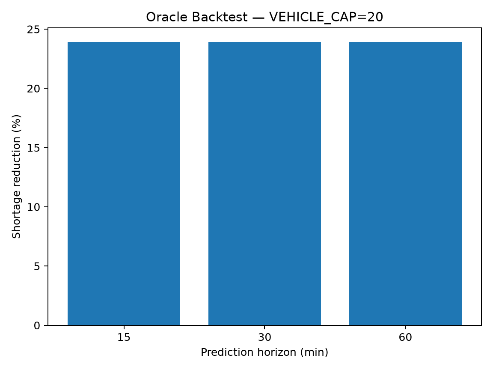

# 10주차 추천·재배치 통합 검증 보고서

관련 이슈: #83

## 1. 검증 범위

이 보고서는 이용자 Best 3 경로 추천과 운영자 재배치 알고리즘의 정량 결과를 한곳에 정리한다. 결과의 근거 수준을 `확정`, `잠정 진단`, `Oracle 상한`, `미검증`으로 구분하여 실제 운영 성능과 이론상 최대 효과가 혼동되지 않도록 하였다.

## 2. 정량 상태 요약

| 영역 | 결과 | 상태 | 해석 |
|---|---:|---|---|
| Random Forest 전체 15분 MAE | 0.639 | 확정 | B1 0.624보다 2.42% 높음 |
| Random Forest 전체 30분 MAE | 0.977 | 확정 | B1 1.000보다 2.22% 낮음 |
| Random Forest 전체 60분 MAE | 1.465 | 확정 | B1 1.581보다 7.33% 낮음 |
| Best 3 경로쌍 최소 기준 전체 성공률 | 95.62% | 잠정 진단 | 잠정 목표 90% 충족 |
| Best 3 경로쌍 안정 기준 전체 성공률 | 90.66% | 잠정 진단 | 전체 목표 충족 |
| Best 3 경로쌍 안정 기준 60분 성공률 | 89.11% | 잠정 진단 | 목표보다 0.89%p 낮음 |
| 재배치 부족 점수 감소율, VEHICLE_CAP=20 | 약 23.92% | Oracle 상한 | 실제 예측 기반 효과가 아님 |
| 재배치 위험 대여소 감소율, VEHICLE_CAP=20 | 약 15.22~15.44% | Oracle 상한 | 실제 예측 기반 효과가 아님 |
| 기존 출발·도착 개별 추천의 실제 재고 포함률 | 산출 불가 | 미검증 | 같은 고정 요청에 대한 과거 추천 결과가 없음 |

## 3. Best 3 경로쌍 추천 결과

최신 28개 KST 완결일에서 181개 대여소 좌표와 15분·30분·60분 예측시간을 조합해 1,459,584건의 요청을 고정하였다. 이 중 1,366,412건(93.62%)에 실제 미래 재고와 평가 가능한 추천 경로가 존재했다.

| 예측시간 | 기준 | 출발 성공률 | 도착 성공률 | 같은 경로쌍 동시 성공률 |
|---:|---:|---:|---:|---:|
| 15분 | 1대·1칸 | 97.73% | 98.86% | 96.55% |
| 30분 | 1대·1칸 | 97.38% | 98.46% | 95.77% |
| 60분 | 1대·1칸 | 96.93% | 97.73% | 94.56% |
| 전체 | 1대·1칸 | 97.35% | 98.35% | **95.62%** |
| 15분 | 2대·2칸 | 94.51% | 97.68% | 92.04% |
| 30분 | 2대·2칸 | 93.79% | 97.23% | 90.82% |
| 60분 | 2대·2칸 | 92.88% | 96.46% | **89.11%** |
| 전체 | 2대·2칸 | 93.73% | 97.12% | **90.66%** |

최소 가용 기준은 모든 예측시간에서 잠정 목표 90%를 넘었다. 안정 가용 기준은 전체와 15분·30분에서 목표를 넘었지만 60분에서는 89.11%로 0.89%p 미달하였다. 예측시간이 길수록 출발과 도착 조건을 같은 경로에서 동시에 만족하기 어려워지는 경향이 나타났다.

### 제외 및 후보 부족

- 고정 요청: 1,459,584건
- 평가 가능 요청: 1,366,412건(93.62%)
- 유효 경로가 없어 제외: 93,093건
- 미래 실제값이 없어 제외: 79건
- 반환 경로가 3개 미만인 요청: 19,040건

## 4. 기존 개별 추천과 경로쌍 추천 비교

기존 화면은 출발 대여소 3개와 도착 대여소 3개를 별도로 제시하였다. 개선된 방식은 출발과 도착을 하나의 경로쌍으로 묶고, 같은 경로 안에서 두 조건이 동시에 만족되는지를 평가한다.

| 비교 항목 | 기존 개별 추천 | 개선된 경로쌍 추천 |
|---|---|---|
| 사용자 선택 | 두 목록을 직접 조합 | 완성 경로 3개 중 선택 |
| 성공 판정 | 출발·도착을 별도 확인 | 같은 경로쌍의 동시 성공 확인 |
| 이동 편의성 | 조합 후 별도 판단 | 전체 ETA와 양쪽 도보시간 반영 |
| 실제 재고 정량 결과 | 과거 고정 요청 결과 없음 | 28개 완결일 결과 산출 |

동일한 고정 요청에 대한 기존 개별 추천의 과거 순위가 보존되지 않아 두 방식의 실제 포함률 차이를 숫자로 직접 비교할 수는 없다. 따라서 화면과 판정 단위의 구조적 개선은 확인하되, 존재하지 않는 비교 수치를 임의 생성하지 않았다.

## 5. 재배치 Oracle 상한 결과

| 예측시간 | 사례 수 | 부족 점수 감소율 | 위험 대여소 감소율 | 총 권장 이동량 |
|---:|---:|---:|---:|---:|
| 15분 | 6,026 | 23.918% | 15.443% | 120,220대 |
| 30분 | 6,026 | 23.919% | 15.238% | 120,160대 |
| 60분 | 6,026 | 23.919% | 15.221% | 120,040대 |

이 결과는 미래 실제 재고를 알고 최적 이동을 계산한 Oracle backtest다. 따라서 알고리즘의 이론상 최대 효과를 나타내며, 예측값으로 계획을 생성한 실제 운영 효과가 아니다. 차량 적재한도 20대에서는 평균 사용량이 약 19.92~19.95대로 한도 포화율이 99.47~99.62%였다. 차량 용량이 성능의 주요 제약으로 작동했음을 의미한다.

## 6. 기준 미달·미검증 항목과 개선방안

### 60분 안정 기준 미달

- 결과: 89.11%, 잠정 목표보다 0.89%p 낮음
- 원인 후보: 장기 예측 불확실성, 현재 재고의 capacity 초과, 후보 부족
- 개선: 60분 특징과 장기 변화 모델 보완, capacity 변경 이력 관리, 후보 반경·점수 민감도 검증

### 최소 90일 사전 이력 미충족

- 확보된 시험 전 이력: 약 34.93일
- 영향: 추천 결과를 공식 최종평가가 아닌 잠정 진단으로만 사용
- 개선: 90일 이상 재고 축적 후 동일 SHA·요청 생성 규칙으로 재평가

### 실제 예측 기반 재배치 효과 미검증

- 현재 수치: Oracle 상한
- 개선: 예측시점에 이용 가능한 정보만으로 계획을 만들고 실제 미래 재고로 counterfactual 평가

### capacity 불일치

- 원본의 `bikes_available > capacity` 값은 보정하지 않음
- 추천 입력에서는 서비스 검증 정책에 따라 후보에서 제외하고 미래 빈 거치대는 0칸으로 해석
- 개선: 대여소별 capacity 변경시점과 API 기준정보를 함께 보존

## 7. 재현 정보

- 재고 스냅샷 SHA-256: `ee6debb89cf0e01d2fe70633f78a0de30844c82e8bf7185a0b9c9c462abcad7d`
- 대여소 기준정보 SHA-256: `8a78dcd633fa7b73f049273fb75fe20856c56d246dd0f90d312cfec3b548bd34`
- 고정 요청 집합 SHA-256: `901a43116e544bca2e20a2e587044e601688db5b4e12178a93cafe8eee1cf2f0`
- 추천 평가 코드: `scripts/evaluate_week10_route_pairs.py`
- 추천 집계표: `reports/week10/route_pair_metrics.csv`
- 재배치 집계표: `reports/week10/oracle_backtest_summary_cap20.csv`
- 재배치 민감도: `reports/week10/oracle_vehicle_cap_sensitivity.csv`

## 8. 결론

Best 3 경로쌍 추천은 최소 가용 기준에서 모든 예측시간이 잠정 목표를 충족했고, 안정 기준에서는 60분만 소폭 미달하였다. 재배치 Oracle 분석은 차량 적재한도 20대에서 약 23.9%의 부족 점수 감소 가능성을 보였으나 실제 예측 기반 효과로 표현할 수 없다. 최종 결과보고서에는 추천 수치를 `잠정 진단`, 재배치 수치를 `Oracle 상한`, 기존 개별 추천 비교를 `미검증`으로 명시해야 한다.
