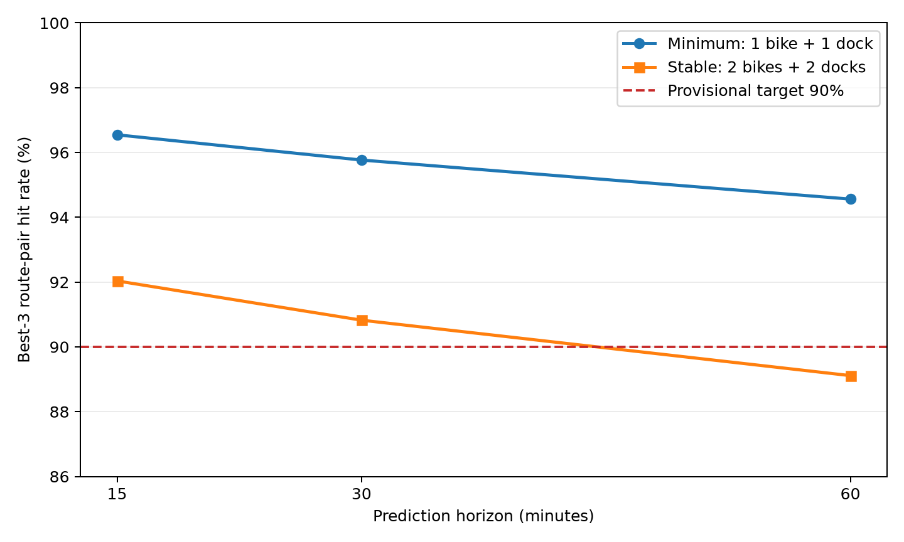

# 10주차 추천 경로 3개 정량평가

관련 이슈: #82

## 결론

최신 28개 KST 완결일에서 출발 대여소와 도착 대여소를 함께 만족하는
Best-3 경로쌍 포함률을 계산했다. 최소 가용 기준(자전거 1대·빈 거치대
1칸)의 전체 동시 성공률은 95.62%, 안정 가용 기준(각 2대·2칸)은
90.66%였다. 최소 기준은 모든 예측시간에서 잠정 목표 90%를 넘었다.
안정 기준은 15분과 30분에서 목표를 넘었지만 60분은 89.11%로
0.89%p 미달했다.

| 예측시간 | 기준 | 출발 성공률 | 도착 성공률 | 경로쌍 동시 성공률 |
|---:|---:|---:|---:|---:|
| 15분 | 1대·1칸 | 97.73% | 98.86% | 96.55% |
| 30분 | 1대·1칸 | 97.38% | 98.46% | 95.77% |
| 60분 | 1대·1칸 | 96.93% | 97.73% | 94.56% |
| 전체 | 1대·1칸 | 97.35% | 98.35% | **95.62%** |
| 15분 | 2대·2칸 | 94.51% | 97.68% | 92.04% |
| 30분 | 2대·2칸 | 93.79% | 97.23% | 90.82% |
| 60분 | 2대·2칸 | 92.88% | 96.46% | **89.11%** |
| 전체 | 2대·2칸 | 93.73% | 97.12% | **90.66%** |

## 평가 방법

- 원본 UTC 시각을 KST로 변환하고 5분 슬롯으로 정규화했다.
- 288개 5분 슬롯과 95% 이상의 대여소 행을 가진 최신 28일을 선택했다.
- 매 15분, 181개 대여소 좌표, 15·30·60분 조합으로 요청을 고정했다.
- 목적지는 대여소 ID 정렬 후 절반 위치만큼 순환 이동해 고정했다.
- 시험구간 이전 자료로만 대여소·요일·시각별 B3 평균 변화를 만들었다.
- B3 조합이 없으면 대여소 평균, 그마저 없으면 B1(변화량 0)을 사용했다.
- 실제 미래 재고는 추천 순위에 사용하지 않고 성공 판정에만 사용했다.
- 경로 3개 중 같은 경로쌍에서 출발 자전거와 도착 빈 거치대가 동시에
  기준을 만족해야 동시 성공으로 판정했다.

## 데이터와 제외 현황

- 전체 고정 요청: 1,459,584건
- 평가 가능 요청: 1,366,412건(93.62%)
- 유효 경로가 없어 제외: 93,093건
- 미래 실제값이 없어 제외: 79건
- 경로가 3개 미만인 요청: 19,040건
- 원본은 수정하지 않았으며 SHA-256은 메타데이터에 기록했다.

## 해석상 제한

이 결과는 잠정 진단 결과다. 사전 계약의 시험 시작 전 최소 90일 이력
요건과 달리 확보된 사전 이력은 약 34.93일이다. 따라서 수치를 공식
최종평가로 확정하거나 모델 선택에 사용하면 안 된다.

원본에는 `bikes_available > capacity`인 행이 다수 있다. 현재 서비스
검증 규칙과 동일하게 이런 행은 추천 시점 후보에서 제외했으며, 미래
판정에서는 원본 자전거 수를 유지하되 빈 거치대만 0으로 해석했다.
이 때문에 유효 경로 제외율과 특히 60분 안정 기준 결과에 영향이 있을
수 있다. 운영 전에는 capacity 기준정보의 시점 일치 여부를 별도로
검증해야 한다.

상세 요청별 결과(약 18MB Parquet)는 원본과 함께 로컬에만 보관하며,
저장소에는 재현 코드, 집계표, 메타데이터와 그림만 포함한다.
