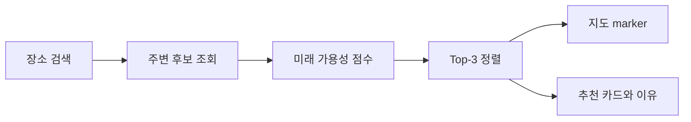

# 김수연 Week 07 추천 UI 검증 보고서

관련 이슈: #39

## 금주 학습목표

- 출발지와 도착지 추천 결과가 각각 Top-3 카드로 표시되는지 검증한다.
- 출발 추천은 미래 예상 자전거 수, 도착 추천은 미래 예상 빈 거치대 수를 중심으로 설명하는지 확인한다.
- 추천 순위·거리·도보시간·점수·추천 이유가 동일한 후보 정보에 근거하는지 확인한다.

## 학습내용

추천 화면은 장소별 주변 후보를 최대 10개까지 받은 뒤 추천 응답의 상위 3개를 표시한다. 출발 카드에는 `bikes_expected`, 도착 카드에는 `docks_expected`가 주 정보로 사용되며 현재 재고는 별도 영역으로 구분된다. 각 카드에는 순위, 대여소명, 거리, 도보시간, 점수 구성과 추천 이유가 함께 표시된다.

## 학습방법

- 병합된 PR #61의 이용자 화면과 추천 mock 계약을 코드 수준에서 대조했다.
- Playwright로 검색, 결과 선택, 추천 카드, 추천 이유와 지도 marker까지 브라우저에서 실행했다.
- 출발·도착 카드가 각각 정확히 3개이며 순위가 추천 결과와 일치하는지 확인했다.
- frontend lint와 production build를 다시 실행했다.

## 학습 성과 및 목표 달성 내용

| 검증 항목 | 결과 |
|---|---|
| 출발 Top-3 카드 | 통과 |
| 도착 Top-3 카드 | 통과 |
| 대여소명·거리·도보시간 | 통과 |
| 출발 미래 예상 자전거 | 통과 |
| 도착 미래 예상 빈 거치대 | 통과 |
| 추천 순위·점수 구성 | 통과 |
| 추천 이유 | 통과 |
| 추천 대여소 지도 marker | 통과 |

이슈 #39의 화면 표시 범위는 자동 E2E로 재현됐다. 실제 운영 환경에서는 backend 추천 endpoint가 준비되면 현재 mock adapter를 실제 응답 adapter로 교체해야 한다.

## 참고자료 및 문헌

- `frontend/src/App.jsx`
- `frontend/src/mocks/recommendationMock.js`
- `docs/recommendation/week08-recommendation.md`
- `tests/test_week08_recommendation.py`
- `frontend/tests/e2e/user-scenarios.spec.js`

## 내주계획

- 실제 추천 backend endpoint가 제공되면 동일 E2E를 live API 환경에서 다시 실행한다.
- 추천 결과가 없거나 일부 후보만 반환되는 경우의 빈 상태를 추가 검증한다.
- Week 8 대표 사용자 시나리오와 전체 UI 오류 검증을 이어서 수행한다.
