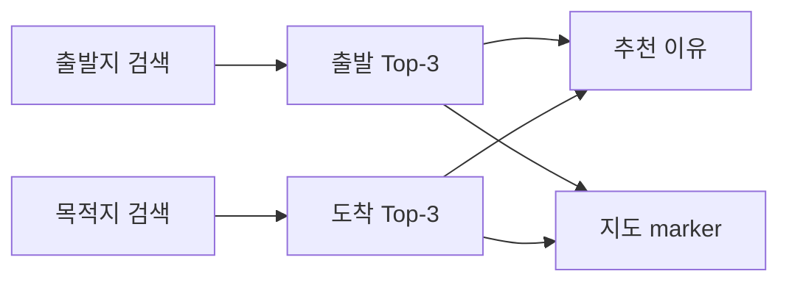

# 김수연 Week 08 대표 사용자 시나리오 QA 보고서

관련 이슈: #40

## 금주 학습목표

- 대표 경로 3개에서 검색부터 추천, 지도와 설명까지 전체 흐름을 재현한다.
- 경로가 달라져도 출발·도착 Top-3 계약이 동일하게 유지되는지 확인한다.
- 외부 API 상태와 무관하게 반복 실행할 수 있는 E2E 환경을 마련한다.

## 학습내용

테스트 전용 장소 검색·대여소 fixture와 Kakao Map stub을 구성해 세 대표 경로를 브라우저에서 실행했다. 각 경로는 장소 검색, 결과 선택, 주변 후보 조회, 미래 가용성 Top-3, 추천 이유와 지도 marker 순서로 검증된다.

## 학습방법

- Playwright로 실제 브라우저 상호작용을 자동화했다.
- MSW fixture로 장소 검색과 주변 대여소 응답을 고정했다.
- Kakao Map 객체는 marker DOM 계약을 유지하는 stub으로 대체했다.
- 각 시나리오에서 추천 카드 수, 추천 이유 수, marker 수와 오류 부재를 검증했다.

## 학습 성과 및 목표 달성 내용

| 시나리오 | 검색 | Top-3 | 추천 이유 | marker 8개 | 결과 |
|---|---:|---:|---:|---:|---|
| 세종대학교 → 성수역 | 통과 | 통과 | 통과 | 통과 | PASS |
| 건대입구역 → 서울숲 | 통과 | 통과 | 통과 | 통과 | PASS |
| 어린이대공원 → 왕십리역 | 통과 | 통과 | 통과 | 통과 | PASS |

대표 사용자 시나리오 3개는 결정적 fixture 환경에서 반복 실행 가능하다. live Kakao 및 backend 연동 결과는 외부 키와 배포 환경이 준비된 뒤 동일 테스트로 별도 확인해야 한다.

## 참고자료 및 문헌

- `frontend/tests/e2e/representative-scenarios.spec.js`
- `frontend/src/mocks/userFixtures.ts`
- `frontend/src/mocks/handlers.ts`
- Playwright Test documentation
- MSW documentation

## 내주계획

- live API 환경에서 동일 경로 3개를 다시 실행한다.
- 네트워크 실패와 빈 추천 응답을 전체 기능 QA에 추가한다.
- 이용자·운영자 화면 전환과 모바일 레이아웃을 이슈 #41에서 검증한다.
