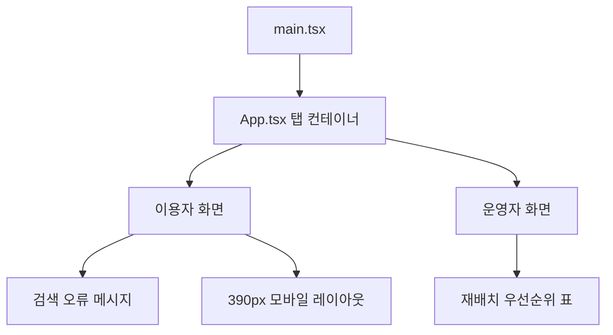

# 김수연 Week 08 전체 UI·오류 상황 QA 보고서

관련 이슈: #41

## 금주 학습목표

- 이용자와 운영자 화면이 실제 진입점에서 정상 전환되는지 확인한다.
- 장소 검색 오류와 모바일 레이아웃을 검증한다.
- 현재 구현된 기능과 선행 작업이 필요한 미검증 범위를 분리한다.

## 학습내용

브라우저 E2E 과정에서 `main.tsx`의 확장자 없는 `./App` import가 탭 컨테이너 `App.tsx` 대신 이용자 화면 `App.jsx`를 선택하는 오류를 발견했다. 그 결과 운영자 탭이 실제 화면에 나타나지 않았다. 진입점을 `./App.tsx`로 명시해 이용자·운영자 화면 전환을 복구했다.

## 학습방법

- Playwright로 이용자·운영자 탭 전환을 실행했다.
- MSW 운영자 fixture로 재배치 우선순위 표 렌더링을 확인했다.
- 두 글자 미만 검색어를 입력해 사용자 오류 메시지를 확인했다.
- 390×844 viewport에서 문서의 가로 overflow를 검사했다.
- frontend lint, production build와 전체 E2E 회귀 테스트를 수행했다.

## 학습 성과 및 목표 달성 내용

| 항목 | 결과 |
|---|---|
| 이용자 화면 | 통과 |
| 운영자 탭 노출 | 오류 발견 후 수정 |
| 운영자 우선순위 표 | 통과 |
| 검색 오류 메시지 | 통과 |
| 390px 모바일 overflow | 없음 |
| 추천 카드·marker 회귀 | 통과 |

현재 저장소에서 실행 가능한 UI·오류·레이아웃 범위는 검증했다. 그러나 실제 운영자 backend 원본과 화면 값의 대조는 이슈 #37의 API가 필요하고, LLM 설명 검증은 Week 9 설명 레이어 병합이 필요하다. 따라서 이 PR은 이슈 #41의 부분 완료 PR이며, 두 선행 작업이 완료될 때까지 이슈 자체는 열린 상태로 유지해야 한다.

## 참고자료 및 문헌

- `frontend/src/main.tsx`
- `frontend/src/App.tsx`
- `frontend/tests/e2e/system-ui.spec.js`
- `frontend/src/pages/OperatorPage.tsx`
- Playwright Test documentation

## 내주계획

- 운영자 API 구현 후 실제 JSON과 표·지도 표시값을 대조한다.
- LLM 설명 레이어 병합 후 추천 이유의 입력 근거성을 확인한다.
- 네트워크 실패·빈 결과·API timeout을 추가 검증한다.
