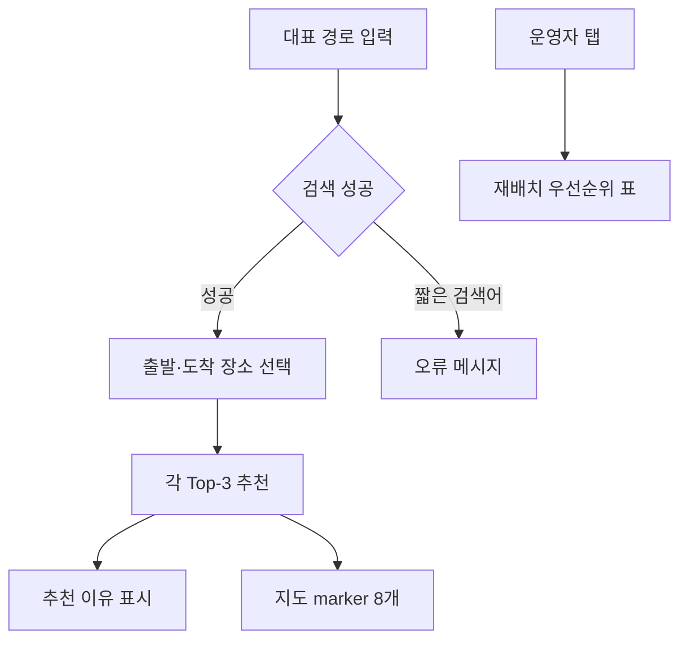

# 김수연 Week 08 사용자 기능 QA 보고서

관련 이슈: #40, #41

## 금주 학습목표

- 대표 사용자 경로 3개에서 검색부터 추천, 지도, 설명까지의 흐름을 재현한다.
- 이용자와 운영자 화면이 하나의 진입점에서 정상 전환되는지 확인한다.
- 검색 오류와 모바일 레이아웃을 포함한 주요 사용자 오류 상황을 검증한다.

## 학습내용

대표 경로는 테스트 전용 검색·대여소 fixture와 Kakao Map stub을 사용해 외부 API 상태와 무관하게 동일하게 재현했다. 이 과정에서 `main.tsx`가 확장자 없는 `./App`을 가져오면서 통합 탭 컨테이너 `App.tsx`가 아니라 `App.jsx`를 직접 선택하는 오류를 발견했다. 진입점을 `./App.tsx`로 명시해 이용자·운영자 탭을 실제 화면에 복구했다.

## 학습방법

- Playwright 기반 브라우저 E2E 환경을 추가했다.
- MSW에 테스트 전용 장소 검색과 주변 대여소 fixture를 추가했다.
- Kakao SDK는 실제 marker 생성 계약을 유지하는 브라우저 stub으로 대체했다.
- 390px 모바일 viewport에서 가로 overflow 여부를 검사했다.
- lint, production build, npm audit와 E2E 전체를 실행했다.

## 학습 성과 및 목표 달성 내용

| 시나리오 | 검색 | Top-3 | 추천 이유 | 지도 | 결과 |
|---|---:|---:|---:|---:|---|
| 세종대학교 → 성수역 | 통과 | 통과 | 통과 | 통과 | PASS |
| 건대입구역 → 서울숲 | 통과 | 통과 | 통과 | 통과 | PASS |
| 어린이대공원 → 왕십리역 | 통과 | 통과 | 통과 | 통과 | PASS |

추가 검증 결과는 다음과 같다.

- 두 글자 미만 검색어 오류 메시지: 통과
- 운영자 탭과 재배치 우선순위 표: 통과
- 390px 모바일 가로 overflow: 없음
- frontend lint: 통과
- frontend production build: 통과
- Playwright E2E: 6개 통과
- npm audit: 취약점 0건

이슈 #40의 대표 시나리오는 결정적 fixture 환경에서 완료했다. 이슈 #41은 장소검색, 추천 카드, marker, 운영자 표, 오류 메시지와 레이아웃까지 검증했다. 실제 운영자 backend 원본 대조와 LLM 설명 검증은 각각 #37과 Week 9 선행 작업이 필요하므로 이번 PR에서 완료로 주장하지 않는다.

## 참고자료 및 문헌

- `frontend/tests/e2e/user-scenarios.spec.js`
- `frontend/src/mocks/userFixtures.ts`
- `frontend/src/mocks/handlers.ts`
- `frontend/src/App.tsx`
- `frontend/src/App.jsx`
- Playwright Test documentation
- MSW documentation

## 내주계획

- 운영자 backend API가 구현되면 fixture와 실제 응답을 동일 요청 기준으로 비교한다.
- Week 9 LLM 설명 레이어가 병합되면 숫자·대여소명·시간 근거성을 별도로 검증한다.
- live Kakao·backend 환경에서 대표 경로 3개를 다시 실행해 fixture 결과와 비교한다.
